# Mermaid ER Diagram Syntax Summary

Mermaid entity-relationship (ER) diagrams start with the `erDiagram` keyword.

## Basic Structure

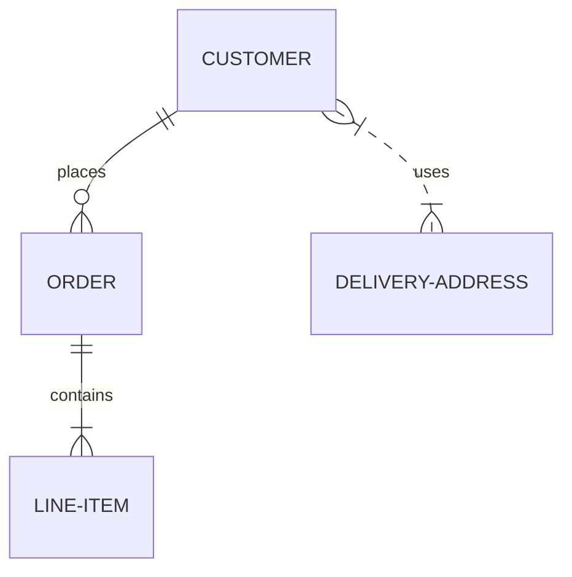

## Specifying Attributes

Attributes and types can be listed for an entity inside curly braces:

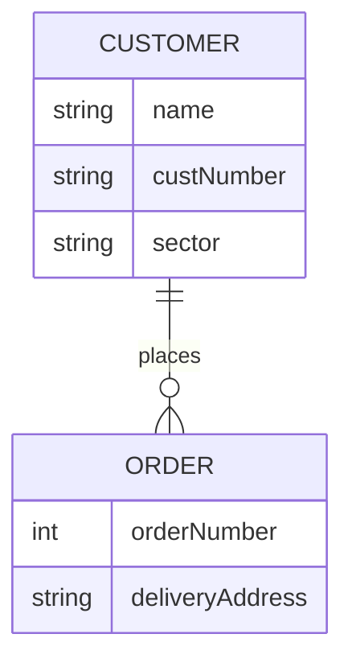

```
erDiagram
    CUSTOMER {
        string name
        string custNumber
        string sector
    }
    ORDER {
        int orderNumber
        string deliveryAddress
    }
    CUSTOMER ||--o{ ORDER : places
```

### Marking Keys

Keys can be marked with the `PK` (primary key), `FK` (foreign key), and `UK` (unique key) keywords, and can also carry a comment:

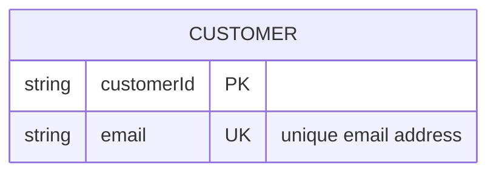

```
erDiagram
    CUSTOMER {        
        string customerId PK
        string email UK "unique email address"        
    }
```

In the `CUSTOMER` table, users are identified by `customerID`, but two users are not allowed to register with the same email address.

## Multi-word / Special Entity Names

Hyphens and underscores in names are not a problem, but if a space or special character is needed, it should be put in quotes:

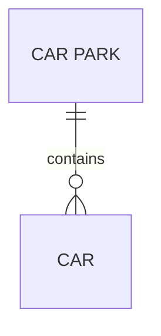

```
erDiagram
    "CAR PARK" ||--o{ CAR : contains
```

## Relationship Without a Label

The `: relationship_name` part can be omitted, but it is recommended to leave empty quotes for a cleaner appearance:

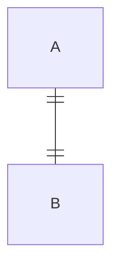

## Full Example

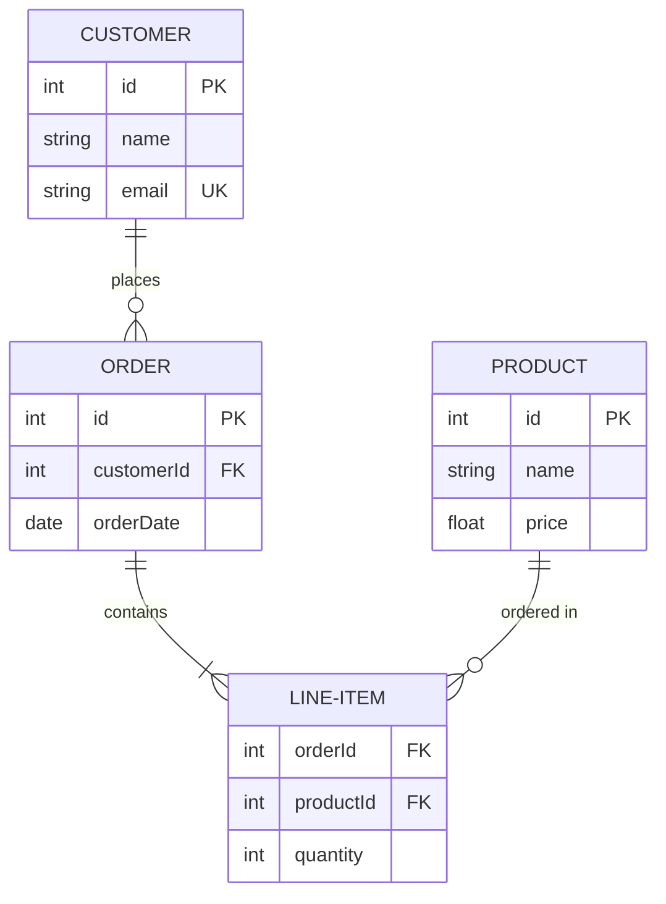

This represents a webshop data model: a customer can place multiple orders, an order can contain multiple line items, and each item is linked to a product.

## 1. One-to-Many (Mandatory) — CUSTOMER / ORDER

The `customerId` field of the `ORDER` table references the primary key of the `CUSTOMER` table as a foreign key.

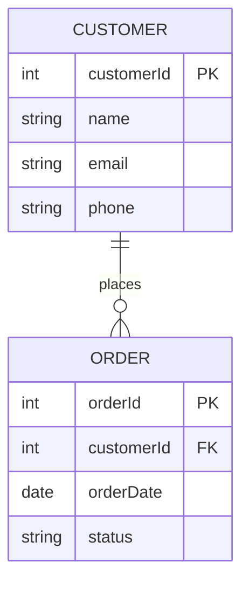

```
erDiagram
    CUSTOMER ||--o{ ORDER : places

    CUSTOMER {
        int customerId PK
        string name
        string email
        string phone
    }
    ORDER {
        int orderId PK
        int customerId FK
        date orderDate
        string status
    }
```

## 2. One-to-One (Mandatory on Both Sides) — PERSON / PASSPORT

The `personId` field of the `PASSPORT` table is both a foreign key and unique (`UK`), since a person can only have one passport.

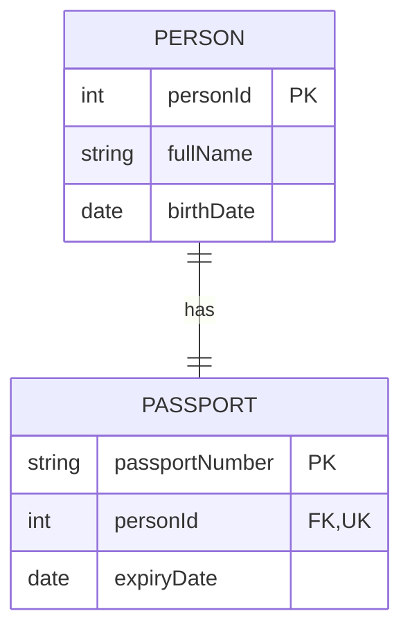

```
    PERSON ||--|| PASSPORT : has

    PERSON {
        int personId PK
        string fullName
        date birthDate
    }
    PASSPORT {
        string passportNumber PK
        int personId FK, UK        
        date expiryDate
    }
```

## 3. One-to-One (Optional) — EMPLOYEE / PARKING-SPOT

The `employeeId` field of the `PARKING-SPOT` table is an optional foreign key (it can be empty/NULL if no employee is assigned).

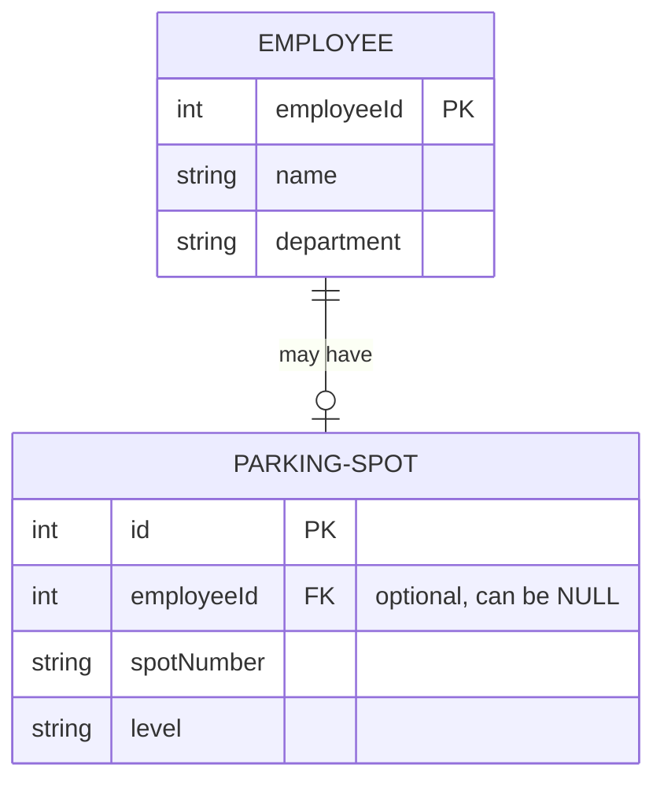

```
erDiagram
    EMPLOYEE ||--o| PARKING-SPOT : "may have"

    EMPLOYEE {
        int employeeId PK
        string name
        string department
    }
    PARKING-SPOT {
        int id PK
        int employeeId FK "optional, can be NULL"
        string spotNumber
        string level
    }
```

## 4. Many-to-Many (Mandatory) — STUDENT / COURSE

A many-to-many relationship requires an intermediate (junction) table, because a simple foreign key could not handle the fact that multiple elements can exist on both sides. The `ENROLLMENT` table contains foreign keys pointing to both sides, which together form the composite primary key.

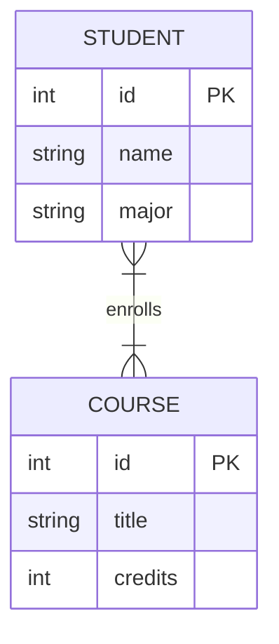

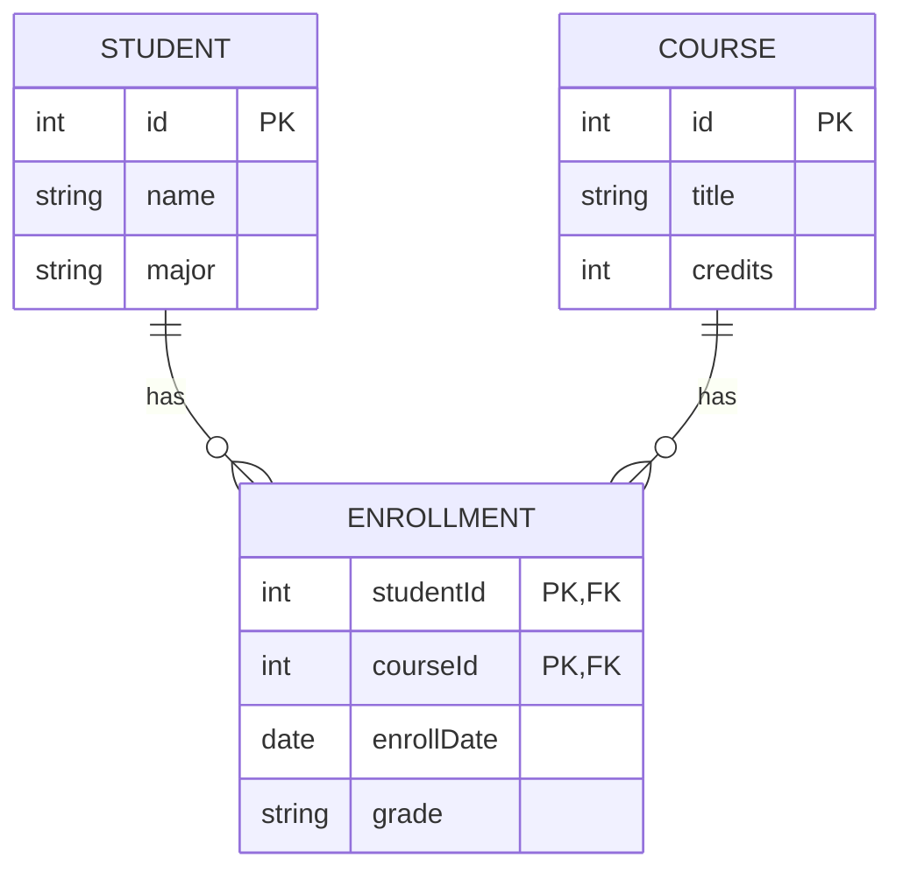

```
erDiagram
    STUDENT ||--o{ ENROLLMENT : has
    COURSE ||--o{ ENROLLMENT : has

    STUDENT {
        int id PK
        string name
        string major
    }
    COURSE {
        int id PK
        string title
        int credits
    }
    ENROLLMENT {
        int studentId PK, FK
        int courseId PK, FK
        date enrollDate
        string grade
    }
```