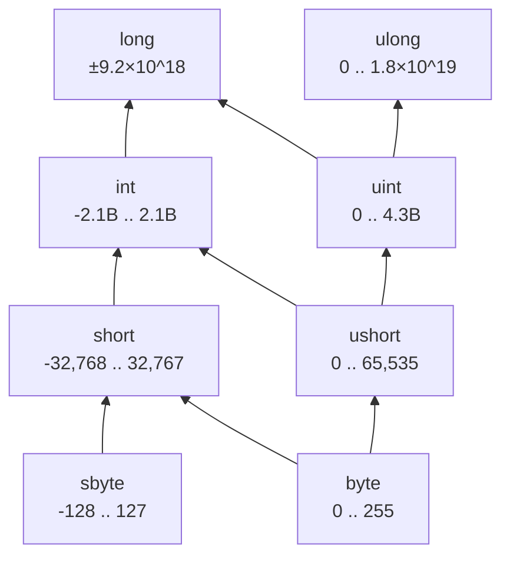

A few notes on why it's shaped this way:

- **byte** sits below both **short** and **ushort** — every byte value fits in either, since byte is non-negative and small enough for both.
- **short** and **ushort** both feed into **int** — their ranges are disjoint at the negative end but both fully fit inside int's range.
- **long** and **ulong** are both "tops," but neither contains the other: ulong's max (~1.8×10¹⁹) is far bigger than long's max (~9.2×10¹⁸), but long can go negative and ulong can't — so they _intersect_ (on 0 .. long.MaxValue) without either containing the other.